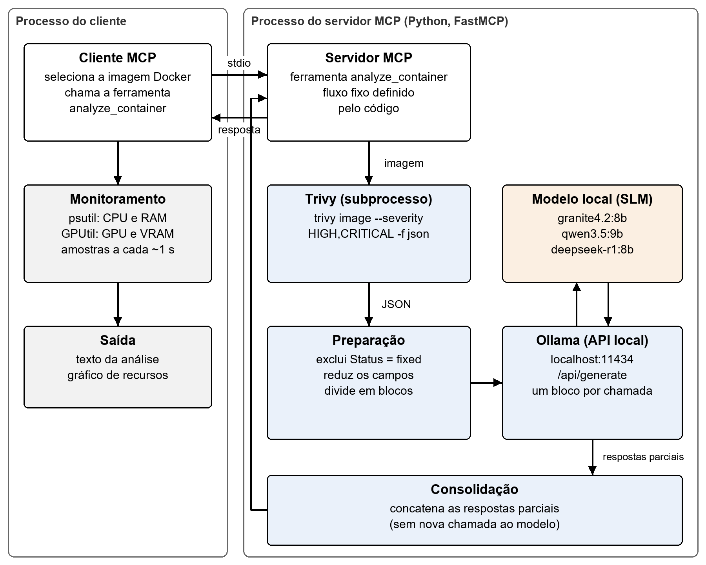
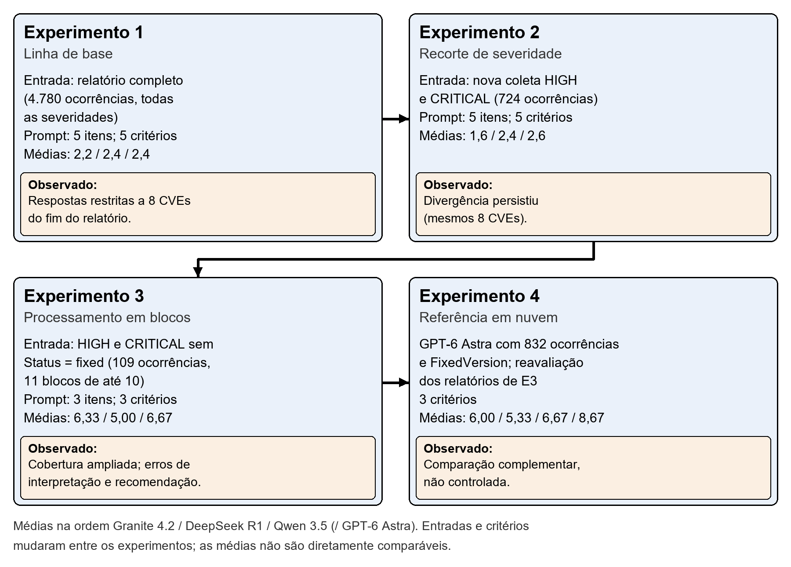
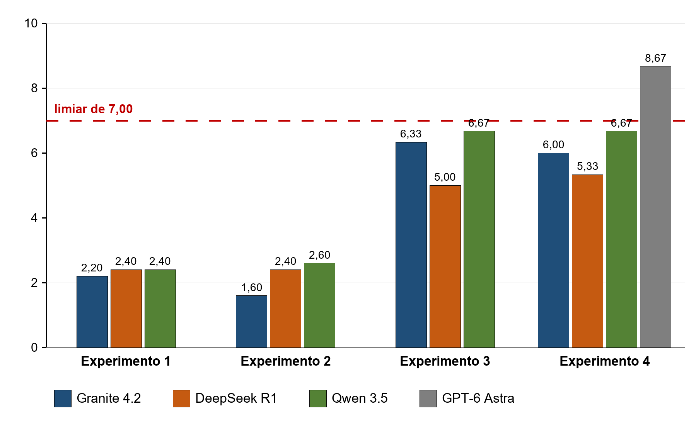

# Agente de Inteligência Artificial Local para Interpretação de Vulnerabilidades em Contêineres Docker com Trivy e Protocolo MCP

Repositório de artefatos do Trabalho de Conclusão de Curso (TCC) desenvolvido no âmbito do curso de Tecnologia em Segurança da Informação da Faculdade de Tecnologia de São Caetano do Sul – Antônio Russo (FATEC São Caetano do Sul), 2026.

A monografia do TCC não está incluída neste repositório. O link para a versão final poderá ser adicionado quando ela for oficialmente aprovada e publicada.

## Autores

O projeto, o protótipo e a monografia são de autoria conjunta dos quatro integrantes do grupo:

- Danilo da Silva Souza
- Gabriel Fernandes Jordão
- Marcio Seabra Bastos Neto
- Thiago Alves de Oliveira

## Orientação

Prof. Dr. Fábio Henrique Cabrini, orientador acadêmico do TCC.

Mais detalhes em [`AUTHORS.md`](AUTHORS.md). Para citar este trabalho, veja a seção [Como citar](#como-citar) e o arquivo [`CITATION.cff`](CITATION.cff).

## Sobre este repositório

Este repositório reúne o projeto técnico do TCC: o código do protótipo, os prompts, os relatórios do Trivy, as saídas dos modelos, os relatórios de avaliação e a documentação, para permitir a verificação dos resultados. A monografia é o documento de referência do trabalho e, em caso de dúvida sobre interpretação, prevalece o seu texto.

## Objetivo

Desenvolver e avaliar um protótipo de agente de IA local, baseado em modelos de linguagem de pequeno porte (Small Language Models, SLMs), integrado ao Trivy por meio do Model Context Protocol (MCP), para apoiar a interpretação de vulnerabilidades identificadas em imagens de contêineres Docker.

O termo "agente" é usado em sentido restrito. O protótipo recebe os dados da varredura, solicita sua interpretação a um modelo e devolve interpretações e recomendações em texto. A sequência de operações é fixa e definida pelo código: o modelo não escolhe ferramentas, não planeja etapas e não aplica correções.

## Arquitetura



| Componente | Papel no protótipo |
|---|---|
| Cliente MCP (`src/version004/Client/mpcclient.py`) | Pede o nome da imagem, inicia o servidor MCP como subprocesso local e se comunica com ele por entrada e saída padrão (stdio). Chama a ferramenta `analyze_container` e, enquanto aguarda, registra o uso de CPU e RAM (psutil) e de GPU e VRAM (GPUtil) a cada segundo, aproximadamente. |
| Servidor MCP (`src/version004/server/mcp-server.py`) | Implementado com FastMCP. A ferramenta `analyze_container` executa o fluxo: varredura, preparação, divisão em blocos, uma chamada ao Ollama por bloco e concatenação das respostas, sem nova chamada ao modelo para consolidar. |
| Trivy (`src/version004/server/tools/trivy_tools.py`) | Executado como subprocesso com `image --severity HIGH,CRITICAL -f json`. Fornece o relatório de vulnerabilidades em JSON. |
| Ollama | Executa localmente o modelo de linguagem, acessado pela API local `http://localhost:11434/api/generate`. |

No Trivy, `Status = fixed` significa que existe correção publicada para o pacote (com `FixedVersion`, quando informada). Não significa que a imagem analisada já recebeu a correção.

## Modelos

| Papel | Modelo | Observação |
|---|---|---|
| Geradores locais (SLMs) | `granite4.2:8b`, `qwen3.5:9b`, `deepseek-r1:8b` | Executados pelo Ollama, *tag* `latest`. O `deepseek-r1:8b` é um modelo destilado. Os *digests* das versões executadas não foram registrados. |
| Avaliador (*LLM-as-a-Judge*) | Fable 5.1 (Anthropic), modo de raciocínio alto | Avaliou as respostas dos Experimentos 1 a 4 e atribuiu as notas. Não gerou respostas avaliadas. |
| Referência em nuvem | GPT-6 Astra (OpenAI), modo de raciocínio alto | Gerou somente a resposta G4 do Experimento 4. Não atribuiu notas. |

As notas são julgamentos do modelo avaliador segundo os critérios definidos nos prompts de avaliação, e não medidas objetivas calculadas automaticamente.

## Experimentos



Todos os experimentos analisaram a imagem `fiware/orion:latest` (Debian 13.4, digest `sha256:dc29ec56888ac7d1a81bac6855fefe3cabcabcaec6bd46a3d9934bb875896edf`). As entradas e os critérios mudaram entre os experimentos, que não são repetições controladas de uma mesma condição. A mensagem exata enviada aos modelos locais não foi preservada em nenhum experimento. Nos Experimentos 1 a 3, os relatórios do Trivy publicados são as referências usadas na avaliação, coletadas depois das saídas dos modelos. No Experimento 4, o arquivo J4 é o conjunto entregue ao GPT-6 Astra.

| Experimento | Referência do Trivy ou entrada registrada | Critérios | Médias (Granite / DeepSeek / Qwen) | Pasta |
|---|---|---|---|---|
| 1 – Linha de base | Referência: relatório completo do Trivy (4.780 ocorrências) | 5 | 2,2 / 2,4 / 2,4 | [`experiments/experimento-1`](experiments/experimento-1) |
| 2 – Recorte de severidade | Referência: nova coleta restrita a HIGH e CRITICAL (724 ocorrências) | 5 | 1,6 / 2,4 / 2,6 | [`experiments/experimento-2`](experiments/experimento-2) |
| 3 – Processamento em blocos | Entrada registrada nas saídas: 109 ocorrências HIGH e CRITICAL sem `Status = fixed`, em 11 blocos | 3 | 6,33 / 5,00 / 6,67 | [`experiments/experimento-3`](experiments/experimento-3) |
| 4 – Referência em nuvem | Entrada do GPT-6 Astra (J4): 832 ocorrências HIGH e CRITICAL; reavaliação dos relatórios locais do Experimento 3 | 3 | 6,00 / 5,33 / 6,67 (GPT-6 Astra: 8,67) | [`experiments/experimento-4`](experiments/experimento-4) |



Nenhum modelo local atingiu o limiar de 7,00, explicitado nas avaliações T2, T3 e T4 (T1 não definiu limiar). A comparação do Experimento 4 é complementar: o modelo em nuvem recebeu uma entrada mais completa (com versões de correção e metadados) do que os modelos locais, de modo que a diferença de notas não isola o efeito do modelo.

Cada pasta de experimento traz um `README.md` com a descrição de cada arquivo e de sua relação com a monografia.

## Estrutura do repositório

```
.
├── README.md
├── src/version004/          Código-fonte do protótipo utilizado no Experimento 3 (lógica sem alterações)
├── experiments/
│   ├── experimento-1/       Referência do Trivy, saídas dos modelos, prompt e relatório de avaliação (T1)
│   ├── experimento-2/       Idem (T2)
│   ├── experimento-3/       Referência do Trivy, saídas dos modelos, prompt e relatório de avaliação (T3)
│   └── experimento-4/       Entrada J4, resposta em nuvem G4, prompt e relatório de avaliação (T4)
├── figures/                 Figuras e gráficos extraídos da monografia
├── docs/PROVENIENCIA.md     Origem e SHA-256 de cada arquivo
├── AUTHORS.md               Autores e orientação
├── CITATION.cff             Metadados de citação
└── LICENSE                  Direitos autorais (todos os direitos reservados)
```

### Artefatos experimentais

Os arquivos em `experiments/` são registros históricos da pesquisa e foram copiados sem nenhuma alteração. Isso inclui caminhos de diretório locais presentes em prompts e relatórios, que foram mantidos por fidelidade. Os códigos usados na monografia correspondem a estes arquivos:

| Código na monografia | Arquivo |
|---|---|
| T1 | `experiments/experimento-1/avaliacao/RESULTADO_COMPARACAO.pdf` |
| T2 | `experiments/experimento-2/avaliacao/RESULTADO_COMPARACAO_TESTE02.pdf` |
| T3 | `experiments/experimento-3/avaliacao/RESULTADO_COMPARACAO_TESTE03.pdf` |
| T4 | `experiments/experimento-4/avaliacao/RESULTADO_COMPARACAO_TESTE04.pdf` |
| G4 | `experiments/experimento-4/resposta-nuvem/TESTE04 - GPT-6-astra-alto.pdf` |
| J4 | `experiments/experimento-4/entrada-trivy/TRIVY_FIWARE_ORION_HIGH_CRITICAL_TESTE04.json` |

Os relatórios de avaliação, as análises de controle dos Experimentos 2 e 3 e a resposta G4 foram produzidos por modelos de linguagem, conforme descrito na monografia.

Os arquivos históricos usam as denominações "Teste 01" a "Teste 04" e "rodada", que correspondem aos Experimentos 1 a 4 da monografia.

## Código do protótipo

O código em `src/version004/` corresponde ao arquivo `version004.zip`, preservado pelo grupo e confirmado como o protótipo utilizado no Experimento 3. A lógica executável está exatamente como foi preservada. Para a publicação, três comentários e os dois arquivos `README.md` do pacote receberam apenas sanitização editorial (linguagem informal, primeira pessoa e um caminho local redundante). O número de linhas foi mantido, de modo que as referências de linha do Apêndice D da monografia continuam válidas. Os detalhes e o SHA-256 dos originais estão em [`docs/PROVENIENCIA.md`](docs/PROVENIENCIA.md). Pontos que devem ser conhecidos antes de usar o código:

- **Tamanho dos blocos:** na execução do Experimento 3, a constante `VULNERABILITIES_PER_CHUNK` tinha o valor `10`, o que produz as 11 partes registradas (10 × 10 + 9). No arquivo preservado, essa constante foi alterada posteriormente para `5`. Esse valor não foi modificado aqui; a diferença é documentada na monografia (seção 3.5 e Apêndice D).
- **Modelo:** o modelo usado é escolhido pela constante `OLLAMA_MODEL` no servidor. No arquivo preservado, ela está definida como `deepseek-r1:8b`, com as demais opções comentadas.
- **Código dos Experimentos 1 e 2:** não foi preservado. Os prompts enviados aos modelos nessas rodadas estão transcritos nos prompts de avaliação.

## Como executar

O procedimento abaixo foi reconstruído a partir do código preservado e **não foi testado durante a preparação deste repositório**. Versões de Python, das bibliotecas e de outros componentes não foram registradas, exceto quando indicado.

### Requisitos conhecidos

- Trivy. Os experimentos usaram as versões 0.71.2 (Experimentos 1 e 2) e 0.74.0 (referência do Experimento 3 e Experimento 4).
- Ollama, com os modelos `granite4.2:8b`, `qwen3.5:9b` ou `deepseek-r1:8b`. A monografia registra a versão 0.34.1 do Ollama.
- Python 3.10 ou superior: o cliente usa a instrução `match`.
- Bibliotecas importadas pelo código, sem versões registradas: `fastmcp` e `requests` (servidor); `mcp`, `psutil`, `matplotlib` e `GPUtil` (cliente).
- O cliente coleta dados de GPU com GPUtil, que lê GPUs NVIDIA. Se nenhuma GPU for encontrada, o código registra 0 para GPU e VRAM.

### Ajustes necessários no código preservado

O arquivo `src/version004/README.md` também indica que o caminho do Trivy precisa ser ajustado. Antes de executar:

1. Em `server/tools/trivy_tools.py`, ajustar `TRIVY_PATH`, que aponta para um caminho local do computador de desenvolvimento.
2. Em `server/mcp-server.py`, a importação `from tools.trivy_tools003 import ...` não corresponde ao nome do arquivo preservado (`tools/trivy_tools.py`).
3. Em `Client/mpcclient.py`, ajustar o caminho do servidor em `StdioServerParameters`, que aponta para um arquivo com outro nome (`mcpservergpt008.py`) no computador de desenvolvimento.
4. Para reproduzir a configuração do Experimento 3, usar `VULNERABILITIES_PER_CHUNK = 10`.
5. Definir `OLLAMA_MODEL` com o modelo desejado e manter o Ollama em execução com esse modelo disponível.

Com os ajustes feitos e o Ollama em execução, o protótipo é iniciado pelo arquivo `Client/mpcclient.py`, executado com o interpretador Python. O cliente inicia o servidor como subprocesso, com o mesmo interpretador, e se comunica com ele por stdio.

O cliente oferece um menu interativo. Somente a opção de imagem Docker (`[ 1 ]`) tem ferramenta correspondente no servidor; as demais opções apenas montam a mensagem. O tipo de scanner escolhido no segundo menu aparece apenas na mensagem exibida: a ferramenta `analyze_container` recebe somente o nome da imagem e sempre executa a varredura de vulnerabilidades HIGH e CRITICAL.

Outros pontos observados no código preservado:

- O relatório gerado é exibido no terminal. Em seguida, o cliente abre o gráfico de recursos em uma janela, e o programa termina quando ela é fechada.
- A ferramenta `get_trivy_version` chama o comando `trivy` pelo PATH, e não pelo caminho definido em `TRIVY_PATH`. Ela não é usada pelo cliente.
- Não foi preservado arquivo de dependências, como `requirements.txt`.

### Limitações de reprodução

- Os resultados do Trivy mudam com a atualização do banco de vulnerabilidades. Uma nova varredura da mesma imagem não reproduz as mesmas contagens.
- A *tag* `latest` dos modelos pode apontar para versões diferentes ao longo do tempo, e os *digests* executados não foram registrados.
- O tamanho de contexto efetivamente usado, a temperatura e outros parâmetros de geração não foram registrados. O código não os fixa na chamada ao Ollama.
- A entrada exata enviada aos modelos não foi preservada. No Experimento 3, ela foi reconstruída a partir das saídas registradas (109 ocorrências em 11 partes).
- As medições de CPU, RAM, GPU e VRAM referem-se ao sistema inteiro, e não somente ao processo do Ollama. Houve uma execução monitorada por modelo, sem repetições.
- Não houve medição de energia, temperatura, custo ou esforço humano.
- A forma de acesso ao Fable 5.1 e ao GPT-6 Astra (interface web ou API) e seus parâmetros não foram registrados. O texto exato entregue ao GPT-6 Astra não foi preservado.
- O equipamento usado está descrito na monografia: AMD Ryzen 7 5800X3D, 16 GB de RAM e NVIDIA GeForce RTX 3070 Ti com 8 GB, em Windows.

## Segurança

O protótipo envia ao modelo textos de terceiros (títulos e descrições de vulnerabilidades) e deve ser tratado como ferramenta experimental de apoio. As respostas exigem revisão humana antes de qualquer ação. O protótipo não aplica correções. A comunicação MCP avaliada ocorreu por stdio entre processos locais, sem servidor exposto em porta de rede; o transporte HTTP aparece no código apenas como alternativa comentada e não foi avaliado.

## Licença e direitos autorais

Este é um repositório público, mas **não é open source**: o código e os materiais são *source-available*, ou seja, ficam disponíveis apenas para consulta, estudo e avaliação acadêmica.

- Todos os direitos são reservados aos quatro autores: Danilo da Silva Souza, Gabriel Fernandes Jordão, Marcio Seabra Bastos Neto e Thiago Alves de Oliveira.
- A consulta, o estudo, a avaliação acadêmica e a citação da pesquisa, com atribuição aos quatro autores, são permitidos.
- Reutilização, redistribuição, publicação de versões modificadas, incorporação em outros projetos e uso comercial exigem autorização prévia dos titulares.
- Os direitos assegurados pela legislação aplicável e as permissões dos Termos de Serviço do GitHub para repositórios públicos, como visualizar o repositório e usar as funcionalidades da plataforma, incluindo o fork, quando aplicável, não são restringidos.
- Materiais de terceiros presentes no repositório permanecem sujeitos aos direitos de seus respectivos titulares.

Os termos completos estão no arquivo [`LICENSE`](LICENSE).

## Como citar

Enquanto a versão final da monografia não estiver oficialmente aprovada e publicada, este repositório pode ser citado como projeto acadêmico:

SOUZA, Danilo da Silva; JORDÃO, Gabriel Fernandes; BASTOS NETO, Marcio Seabra; OLIVEIRA, Thiago Alves de. **Agente de Inteligência Artificial Local para Interpretação de Vulnerabilidades em Contêineres Docker com Trivy e Protocolo MCP**. São Caetano do Sul, 2026. Projeto de Trabalho de Conclusão de Curso – Faculdade de Tecnologia de São Caetano do Sul – Antônio Russo, curso de Tecnologia em Segurança da Informação. Orientador: Prof. Dr. Fábio Henrique Cabrini.

Após a aprovação e publicação oficial da monografia, esta seção poderá ser atualizada com a referência bibliográfica definitiva.

Os metadados de citação do projeto também estão disponíveis em formato legível por máquina no arquivo [`CITATION.cff`](CITATION.cff).
